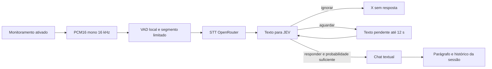

# Arquitetura do MVP

`StudyWhisper.Core` não depende de UI ou dispositivos: VAD, WAV, pipeline, orçamento, relógio do popover e adaptadores de API. `StudyWhisper.App` é WPF com `NotifyIcon` de WinForms; o host é WPF. `Microphone` usa WinMM em modo de evento, evitando chamadas de áudio dentro de callbacks nativos. Testes usam um `HttpMessageHandler` que nunca abre conexão e um `IStudyApi` fictício.

## Modos de captura

O controlador mantém uma única entrada de áudio. Os botões dos dois modos e a ação Iniciar/Parar compartilham o mesmo estado no indicador e no painel. A captura bloqueia a seleção de modo. Parar fecha a fonte imediatamente. Em Transcrição, a fila conclui os trechos de áudio já recebidos e o journal registra o estado final. Retomar a escuta exige outra ação do usuário.

Perguntas usa o pipeline abaixo. Transcrição usa apenas STT e mantém o alinhamento local de janelas sobrepostas. O painel apresenta os trechos na ordem de captura e indica lacunas. Abrir o painel pelo círculo mostra o conteúdo do modo selecionado. As respostas aparecem no painel enquanto ele está aberto. Com o painel fechado ou minimizado, chegam ao balão passivo. Trocar de modo fecha o balão.

A abertura de um histórico antigo remove os campos de reescrita dos registros por substituição atômica de cada arquivo e descarta os arquivos de progresso dessa função. Os segmentos originais, seus timestamps e a consolidação das sobreposições continuam no histórico.

## Fluxo do modo Perguntas

A captura mantém quadros de 20 ms. Produção remonta blocos de 32 ms para Silero ONNX CPU, com pré-roll de até 320 ms, início após dois blocos com probabilidade suficiente, histerese e fim após 800 ms de silêncio com margem final de 256 ms. Limites de segmento usam sobreposição de 256 ms. A implementação RMS permanece apenas para comparação offline/demonstração. Silero não identifica falante, intenção ou pergunta. A entrada usa o dispositivo de gravação padrão do Windows. Leia [triagem neural e métricas](AUDIO-TRIAGE.md) para definições, margens e perdas possíveis.

São quatro buffers nativos de 640 bytes e no máximo 30 segundos por segmento. O pipeline admite uma solicitação por vez e até dois segmentos pendentes com expiração de 30 s. Excesso substitui e zera o pendente mais antigo; pausa/limpar/sair esvazia a fila. Retomar não envia segmentos anteriores à pausa. Buffers de PCM e WAV são limpos no consumo, pausa e descarte. Base64, chave e texto usam strings gerenciadas: não há promessa de remoção física imediata da RAM pelo GC.

## Cancelamento e memória

Uma geração e um `CancellationTokenSource` protegem cada execução. Pausar e limpar avançam a geração, cancelam tarefas e recusam resultados antigos, inclusive de mock que ignora o token. Pausa não apaga histórico; limpar apaga histórico e texto incompleto. Configurar modelos pausa e mantém histórico. A memória é habilitada por padrão e inclui os últimos dez pares completos de pergunta e resposta, com perguntas até 4.000 caracteres e respostas até 6.000. A sessão mantém no máximo 30 respostas.

O JEV recebe critérios para responder apenas a perguntas claras de estudo, aguardar fala incompleta e ignorar enunciados/comentários/interjeições/comandos sem pergunta. `answers.action` deve ser `choice`, com label reconhecido e probabilidades finitas entre 0 e 1, somando aproximadamente 1. Só `responder` com probabilidade pelo menos 0,65 chama chat. Esse limiar é uma decisão inicial do MVP, não uma medida de precisão calibrada. Resposta vazia ou formato inválido falham sem exibir conteúdo remoto de erro.

## Janelas e instalação

Círculo e popover são topmost e `WS_EX_NOACTIVATE`, com `ShowActivated=false` e `WM_MOUSEACTIVATE` retornando `MA_NOACTIVATE`. Configurações ganha foco apenas quando aberta por ação do usuário. O círculo ancora à área de trabalho da tela principal; acompanha mudanças dessa área. O app não implementa arraste, escolha de monitor ou garantias sobre fullscreen exclusivo.

Configurações suporta 580 × 450 até 660 × 740 DIP e usa rolagem. O popover cabe na área disponível abaixo do círculo. Seu relógio não consome tempo em hover/captura de mouse; rolagem e clique reiniciam o tempo. Respostas novas preservam a posição de leitura se o mouse estiver no painel.

O instalador Inno Setup é por usuário, com runtime incluído. Inicialização opcional usa somente `HKCU\Software\Microsoft\Windows\CurrentVersion\Run\StudyWhisper`; nenhum registro é alterado nos testes. A desinstalação remove essa entrada. O build usa manifest de DPI para WPF; o aviso de DPI do analisador WinForms é suprimido porque WinForms fornece apenas a bandeja.

## Monitor vetorial 0.1.4

SpeechGate e Pipeline emitem eventos tipados sem áudio/texto. FlowState mantém resultados por etapa e separa atividade de entrada/fila da chamada ativa. Controller serializa publicação, recusa gerações/pipelines antigos e coalesce atualizações de Spectrum (FFT local a 10 Hz). OrbWindow renderiza formas WPF e glifos, com timer decorativo de até 15 Hz só durante atividade, respeito à preferência de movimento e nenhuma ativação automática de janela. Veja [contrato visual e limites](VISUAL-MONITOR.md).

## Indicador circular 0.1.5

O overlay permanece 72 × 72 DIP em toda etapa. OrbWindow seleciona uma única LensScene pelos mesmos eventos de FlowState; o nome legado Expanded representa apenas detalhe ativo, não expansão física. Desenho externo e cenas internas usam clipping circular, com fade de 150 ms só da nova cena. Filtro/microfluxo, STT/glifos, decisão JEV e geração se alternam dentro do círculo. A fila é um pequeno badge interno e um tooltip. Popover e NOACTIVATE permanecem. O modelo/API/VAD/espectro e preflight Visual C++ não mudam nesta correção. O código anterior foi arquivado em artifacts/StudyWhisper-0.1.4-source.zip. [Contrato visual atual](VISUAL-MONITOR.md).

Pesquisa, Markdown, estilos e diagnóstico de limites: veja [Conversa 0.1.6](CONVERSATION.md).

## Recuperação local e fechamento externo, 0.1.10

`Microphone` relata operação, código WinMM e categoria da falha, sem mensagens externas nem conteúdo capturado. `CaptureRecovery` descarta e fecha a instância de captura que falhou, reinicia somente o estado acústico e tenta uma nova entrada com espera progressiva limitada a 60 s. Uma geração e um token impedem reabertura após pausar, sair ou substituir a captura. O callback de falha não espera o próprio worker; fechamento e reconexão ocorrem fora dele. Falha de formato ou dependência não entra em repetição infinita. Diagnóstico local é limitado a dois arquivos de aproximadamente 32 KiB de metadados.

A recuperação não chama `Pipeline.Pause`, não apaga histórico/fila e não recria STT, decisão ou resposta já em execução. Os limites e a expiração normal da fila continuam vigentes. Pausa explícita continua cancelando e limpando áudio temporário. Nenhuma chamada paga é repetida automaticamente e nenhuma política de provedor é relaxada.

`OutsideClickDismissal` observa apenas pressionamentos de botões enquanto o menu ou histórico está visível; compara os limites das janelas, agenda o fechamento no dispatcher e devolve o evento ao Windows. Não guarda coordenadas nem eventos. Clique dentro, navegação nativa e o menu da bandeja são preservados. Fechar uma superfície remove o observador; ocultar o histórico não pausa o pipeline. O círculo é considerado parte da superfície do histórico para permitir seu clique de alternância normal.

## Continuidade e indicadores de entrada, 0.1.11

Após uma fronteira forçada, `quiet` inclui silêncio de antes do corte, mas `segment` retém somente a sobreposição. Subtrair todo esse silêncio do novo segmento produzia um índice negativo. O recorte agora é limitado ao trecho presente; `exportedUntil` impede reemitir uma cauda cujo fim já foi exportado. O bloco de probabilidade é limpo em `finally`, mesmo quando o consumidor falha.

O callback local contém falhas do filtro e tenta reiniciar seu estado sem fechar WinMM. Três falhas consecutivas ou dependência indisponível bloqueiam o processamento com aviso, enquanto contadores distinguem entrada de dados e processamento. O encerramento desabilita o pipeline antes de esperar o worker, impedindo um novo envio a partir do último quadro em voo.

`CaptureRecovery` confirma Ready somente no primeiro quadro de uma fonte válida. Conta quadros/amostras, idade do último quadro e aberturas. Um watchdog de 500 ms verifica ausência de quadros por dois segundos; recuperação usa 100, 250, 500 ms, 1, 2 e até 5 s. A identidade da fonte e a geração recusam falhas e callbacks antigos, inclusive após nova captura. Nenhuma repetição paga é introduzida.

O limite remoto continua intacto. Uma nova pergunta necessita margem de até três chamadas; com 299/300 usadas, novos envios são bloqueados, mas a entrada continua capturando e filtrando. O indicador de microfone com legenda Limite exige quadros recentes; a espera de captura real permanece distinta no aviso e nos contadores.

Um arquivo `update-session.dpapi` existe somente para uma transferência local explicitamente autorizada de atualização. Histórico e orçamento são lidos sem alterar `settings.json` ou a chave, e o estado anterior pode retomar a escuta após o preflight. O arquivo é apagado após os primeiros quadros. Não há gravação de áudio, persistência automática de sessões normais ou relaxamento da política de provedor.

A saída do 0.1.10 também foi observada bloqueada em `StylusWisp.WispTabletDeviceCollection` / `PenThreadWorker.WorkerGetTabletsInfo`, após as janelas e a captura já terem fechado. O runtimeconfig do 0.1.11 habilita a pilha WPF WM_POINTER, suportada no Windows 10/11, para evitar a enumeração WISP nesse caminho. A validação do pacote e a saída/reabertura real conferem o encerramento; mouse e teclado permanecem nativos.

## Contabilidade sem teto interno, 0.1.12

`CallTracker` substitui `CallBudget`: guarda somente a contagem acumulada e o cooldown comunicado pelo provedor. Não mantém bucket por minuto, teto por sessão, reserva de três chamadas nem teto monetário. O preflight verifica apenas cooldown; cada tentativa de inferência incrementa a contagem, inclusive falhas. `usage.cost` continua sendo contabilizado por etapa quando informado. Catálogo e validação de chave não contam como inferência; a busca opcional pode gerar custo dentro da resposta sem constituir outra requisição de inferência feita pelo app.

Os campos `CallsPerMinute` e `SessionCallLimit` foram removidos do modelo de configuração e da interface. Uma atualização preserva o contador existente e o snapshot de contadores/custos; não zera o histórico para fazer o processamento voltar. `RestoreUsedForUpdate` aceita contagem não negativa sem limiar máximo de negócio. O armazenamento numérico usa 64 bits. Os limites técnicos de payload, fila, contexto, tokens, busca por resposta e cancelamento continuam vigentes.

## Finalização da gravação, 0.1.16

Depois de drenar STT e selar a captura, `RecordingSession.StopAsync` chama `IRecordingRewriter` uma única vez. A tarefa de parada é idempotente e `WhenIdle` inclui a revisão. O estado de captura e o de reescrita são separados; cancelar somente a reescrita preserva a captura concluída. O journal v2 conserva o original e persiste `FinalText`, `RewriteState` e `RewriteNotice` em registros terminais compatíveis. Recuperação de reescrita interrompida não inicia chamadas remotas.

`OpenRouter.RewriteRecordingAsync` divide o texto completo em partes de até 6.000 bytes UTF-8, preserva limites de caracteres e fornece contexto adjacente. Cada parte tem prazo de 180 segundos e limite de 12.000 tokens de saída. O resultado só é publicado quando todas terminam e passam pelas verificações de números, negações e marcadores. Isso detecta falhas específicas; não comprova fidelidade semântica. O Rewrite manual canônico mantém seu contrato próprio.

O controlador pausa a escuta durante a revisão explícita de uma gravação salva, aguarda as operações anteriores e restaura o estado de escuta ao concluir. Os painéis de original e final crescem com a janela e preservam seleção, rolagem e a proporção escolhida no divisor. Detalhes em [gravação 0.1.16](RECORDING-0.1.16.md).

## Painel unificado, 0.1.18

No aplicativo, OrbToolsPanel incorpora os tres botoes inferiores na mesma OrbWindow. A janela completa mede 104 x 104 DIP, preserva NOACTIVATE e usa essa dimensao na ancoragem. O indicador isolado mantem 72 x 72 DIP. A janela separada de acoes foi removida; veja [menu unificado](MENU-0.1.18.md).

## Navegacao unificada, 0.1.19

DashboardWindow incorpora as superficies existentes em uma janela navegavel, sem interromper captura ou revisao ao trocar de secao. O evento local Pipeline.Transcribed alimenta um historico de ate 30 transcricoes em RAM, separado do fluxo de diagnostico sem texto. Reescritas avulsas tambem ficam em RAM; o journal de gravacoes permanece inalterado. Veja [painel navegavel](PANEL-0.1.19.md).
